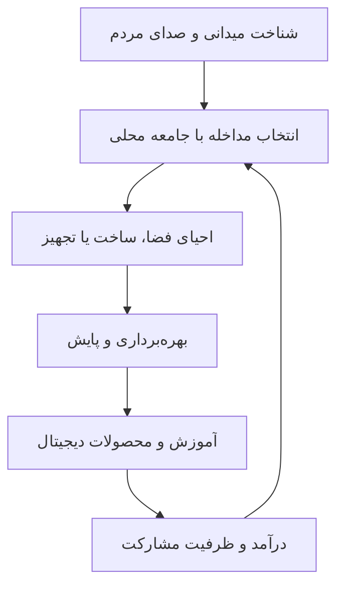

<strong>شهر یاد می‌گیرد، روستا ساخته می‌شود</strong> Architecture · Education · Local Communities · Digital Innovation

<a href="https://marazawa.com">Website</a> · <a href="docs/PRODUCTS.md">Products & Demos</a> · <a href="docs/PARTNERSHIPS.md">Partner with us</a> · <a href="README.en.md">English</a>

## مارازاوا در یک دقیقه

مارازاوا اکوسیستمی در حال توسعه برای پیوند آموزش، کارآفرینی، معماری و اقتصاد جوامع محلی است. از مشاهده میدانی و گفت‌وگو با مردم شروع می‌کنیم، نیاز و ظرفیت را می‌شناسیم، یک مداخله کوچک و کاربردی را طراحی می‌کنیم و مسیر بهره‌برداری و پایش آن را دنبال می‌کنیم.

محصولات دیجیتال و خدمات آموزشی، در کنار مشارکت شرکت‌ها، ظرفیت گسترش این مأموریت را ایجاد می‌کنند. پیش از ساخت بنای تازه، امکان احیای کلاس خالی، اتاق موجود و فضای بلااستفاده بررسی می‌شود.

**این مخزن، ویترین و مستندات معرفی مارازاواست. کد اجرایی وب‌اپ‌ها هنوز به این بسته وارد نشده است.**

## محصولات و دموها

| محصول | مسئله هدف | وضعیت قابل تأیید | مشاهده |
|---|---|---|---|
| موتور توسعه روستایی | تبدیل شناخت میدانی به تصمیم قابل بررسی درباره فضا و خدمات | وب‌اپ منتشرشده؛ اعتبارسنجی میدانی و ممیزی فنی در برنامه | [دمو](https://marazawa-rural-engine.regal-pixie-5335.chatgpt.site) |
| MARAZAWA Skill DNA | تبدیل تجربه به مهارت دیجیتال | دموی تعاملی منتشرشده؛ مدل و دامنه قابلیت‌ها نیازمند بررسی کد | [دمو](https://marazawa-skill-dna-demo.regal-pixie-5335.chatgpt.site) |
| از ایده تا شروع | طراحی مسیر کسب‌وکار، پروپوزال و وبسایت برای شروع | سایت معرفی منتشرشده؛ گردش پرداخت و تحویل خودکار تأیید نشده | [مشاهده](https://idea-to-start.regal-pixie-5335.chatgpt.site) |

لینک و وضعیت انتشار از فهرست پروژه‌های مالک در ۱۲ اکتبر ۲۰۲۶ بررسی شده است؛ این بررسی به معنی آزمون همه قابلیت‌ها یا تضمین دسترسی دائمی نیست.

## مسیر خلق ارزش

## چرا مارازاوا؟

- **پیوند میدان و محصول:** نیاز واقعی جامعه محلی، نقطه شروع طراحی است.
- **شناخت فضا:** معماری و طراحی شهری به تصمیم درباره ساخت، احیا و بهره‌برداری وصل می‌شوند.
- **ترکیب یادگیری و کارآفرینی:** خدمات دیجیتال می‌توانند به درآمد مستقل پلتفرم کمک کنند.
- **روایت انسانی:** مسیر پروژه قابل مستندسازی و معرفی به جامعه و شرکا است.
- **اثر قابل سنجش:** استفاده واقعی از فضا، تداوم خدمت و هزینه بهره‌برداری باید در پایلوت ثبت شوند.

این‌ها ظرفیت و جهت‌گیری راهبردی‌اند؛ برتری بازار و اثر نهایی هنوز باید با داده پایلوت اثبات شوند.

## بنیان‌گذار و بستر فعالیت

**پویا صفدرپور | Pouya Safdarpour** — معمار، طراح شهری، هنرمند و بازیگر؛ بنیان‌گذار و راهبر مارازاوا. کارشناسی معماری (۲۰۰۷)، کارشناسی ارشد طراحی شهری (۲۰۱۳) و حدود پانزده سال تجربه در شهرداری تهران.

مارازاوا در بستر شرکت مهندسین مشاور **آگر شار آریا** فعالیت می‌کند و مطابق اطلاعات ارائه‌شده از سوی بنیان‌گذار، عضو زیست‌بوم مرکز کارآفرینی دانشگاه صنعتی شریف است. این عضویت به معنی تضمین دانشگاه، مالکیت دانشگاه یا تأیید علمی محصولات نیست.

## برای شتاب‌دهنده‌ها و شرکای توسعه

به دنبال همکاری برای تبدیل دموها به محصول قابل عرضه، اعتبارسنجی تقاضا، توسعه تیم فنی و اجرای پایلوت میدانی هستیم. پیشنهاد شروع: **یک پایلوت ۹۰روزه با دامنه روشن، تحویل مرحله‌ای و شاخص‌های مورد توافق**.

[پیشنهاد همکاری](docs/PARTNERSHIPS.md) · [برنامه توسعه](docs/ROADMAP.md) · [چارچوب سنجش اثر](docs/IMPACT.md)

## نقشه این مخزن

| فایل | کاربرد |
|---|---|
| [معرفی انگلیسی](README.en.md) | بررسی توسط مخاطبان بین‌المللی |
| [محصولات](docs/PRODUCTS.md) | مسئله، مخاطب، مسیر درآمد و وضعیت محصولات |
| [همکاری](docs/PARTNERSHIPS.md) | درخواست‌ها و پیشنهاد پایلوت برای شرکا |
| [نقشه راه](docs/ROADMAP.md) | اولویت‌های اجرایی و شروط انتشار تجاری |
| [اثر اجتماعی](docs/IMPACT.md) | روش ثبت و ارزیابی نتایج |
| [فناوری و مهارت‌ها](docs/TECHNOLOGY.md) | حدود AI، معماری پیشنهادی و فهرست مهارت‌ها |
| [فهرست شواهد](docs/EVIDENCE.md) | منابع معرفی و مدارک مورد نیاز |
| [کتابخانهٔ منابع کسب‌وکار](docs/research/BUSINESS-RESOURCE-LIBRARY-2026-10-25.md) | ۲۸ مرجع منتخب برای کشف فرصت، مدل درآمد، اقتصاد، آزمون و نقشهٔ راه؛ همراه JSON و CSV |

| [مرجع مالی و امکان‌سنجی](docs/research/FINANCE-FEASIBILITY-KNOWLEDGE-2026-10-25.md) | ۳۳ منبع کارآفرینی، طراحی مالی و امکان‌سنجی؛ نگاشت کاربرد و محدودیت حقوق محتوا، همراه JSON و CSV |

| [کتابخانهٔ توسعه و معماری پایدار](docs/research/sustainability-architecture/README.md) | ۳٬۱۹۹ مقالهٔ DOIدار یکتا در ۳۶ شاخه + ۱۲ مرجع رسمی؛ همراه دادهٔ موضوعی، روش و گزارش ممیزی |

## ارتباط

[marazawa.com](https://marazawa.com) · [Instagram: marazawa_](https://www.instagram.com/marazawa_/) · [Marazawa Academy](https://www.instagram.com/marazawaacademy/)

© MARAZAWA. انتشار این معرفی به معنی اعطای مجوز استفاده از نام تجاری، محتوا یا کد نیست. مجوز هر کد یا دارایی، در صورت انتشار، جداگانه تعیین می‌شود.